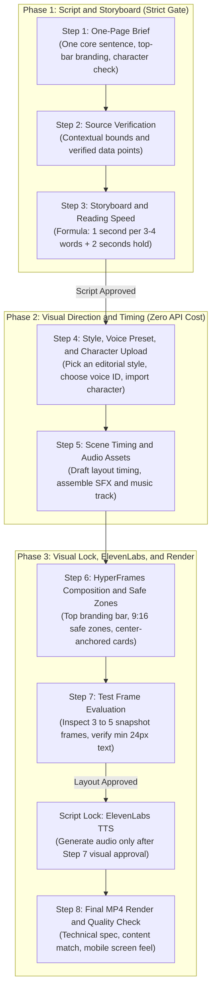

# Motion Graphics with HyperFrames: The 8-Step Production Pipeline

This skill codifies the production workflow from the **Beginner's Motion Guide** (`@Traa-Bud` / `@wgmpb`), combined with **TASTES.md** editorial rules, seven **Bang Motion** design modes, the **HyperFrames** render engine, top-bar branding rules, character rigging, and an ElevenLabs credit protection protocol.

---

## Three Non-Negotiable Rules

1. **Strict Sequence**:
   Never start by asking about visual styles or voice options. Educational video begins with substance: **One-Sentence Takeaway -> Script -> Storyboard**.
2. **Deferred Voice Synthesis (Script Lock)**:
   Hold ElevenLabs API calls until Step 7 (Test Frame Evaluation) is approved by the human user. Never burn paid voice credits before the script and visual layout are locked.
3. **Top Branding Bar**:
   Every vertical video must place a top bar right below the upper safe margin:
   - **Top-Left**: Series title, topic, or category tag.
   - **Top-Right**: Creator handle or account credit (example: `@yourhandle`).

---

## The 8-Step Pipeline



---

## Step-by-Step Production Guide

### Step 1: One-Page Brief, Top-Bar Branding, and Character Check
Before drafting a script, align on the core brief:
1. **Core Message (Exactly One Sentence)**:
   > [!IMPORTANT]
   > If the core takeaway cannot be stated in **exactly one sentence**, the brief is not finished. Do not write script lines until this sentence is locked.
2. **Target Duration**: 60 seconds (125 to 135 words) or 75 seconds (155 to 165 words).
3. **Top Branding Bar**:
   - **Top-Left**: Propose or request a short topic title (example: `AI INFRASTRUCTURE`, `POP SCIENCE #03`, or `DIGITAL ECONOMY`).
   - **Top-Right**: Request the creator account handle (example: `@yourhandle` or studio name).
4. **Character Host Check**:
   - Ask directly: *"Will this video feature a character or mascot host, or rely strictly on technical diagrams, product cutouts, and typography?"*
   - If using a character: remind the user to prepare a transparent PNG or SVG cutout for Step 4.
   - If using no character: focus visual direction on concrete object cutouts, data cards, and schematic diagrams.
5. **Tone**: 3 descriptive words (example: *reflective, authoritative, calm*).
6. **Negative Constraints**: Things to avoid (example: generic glossy 3D visuals, loud neon palettes).

---

### Step 2: Research and Source Verification
1. Every technical statistic must cite its source and contextual boundaries.
2. For religious, historical, or legal citations: include the exact book, chapter, or verse number, labeled as a summary of meaning.

---

### Step 3: Storyboard and Reading-Speed Timing
Split the script into 5 or 6 measured beats. Draft voice narration and on-screen display text:
1. **Reading Speed Formula for Text Cards**:
   $$\text{Display Duration} \ge \left( \frac{\text{Word Count}}{3.5} \right) + 2.0\text{ seconds}$$
   - Example: A card with 14 words needs at least **6.0 seconds** of hold time on screen.
2. **One-to-One Visual Pairing**:
   - The concrete visual element in each beat must directly match what the voice speaks.
3. **Calm Camera Motion**:
   - Keep the camera stationary while viewers read on-screen text cards.

> [!NOTE]
> **GATE 1 (SCRIPT APPROVAL)**: Hand the script and storyboard to the user for review. Advance to Step 4 only after the user approves the text.

---

### Step 4: Visual Style, Voice Selection, and Character Import
Guide visual and audio aesthetics once the script is locked:
1. **Choose an Editorial Style**:
   - TASTES.md standard (cream paper `#fcfbf9`, charcoal `#1c1917`, terracotta `#c2410c`, font *Fraunces*).
   - Or one of the seven Bang Motion modes:
     1. *Collage Cartoon* (cream textured paper, cutouts, handwriting with `Caveat`)
     2. *Visual Journalism* (black background, archive photography, highlighter ink)
     3. *Minimalist White Catalog* (white and ivory grid, hardware, physical rubber stamps)
     4. *Vintage Engraving* (sepia parchment, classic copperplate etching, serif type)
     5. *Vector Route* (flowing isometric camera moves with running telemetry)
     6. *Stage Puppet* (bright stage colors, interactive character actions)
     7. *Kinetic Typography* (Swiss poster layout, high-contrast type with `Sora` 900)
2. **Receive Character Cutout**:
   - If a host character was chosen in Step 1, import the transparent PNG asset with clothes, arms, and sneakers intact.
3. **Select ElevenLabs Voice Preset**:
   - Agree on a voice profile: *Adam, Roger, Rachel, British (`qkG6pQFWpZTnYnoQZGFs`)*, or a custom voice ID.
   - Remind the user that the API call is held until Step 7 to avoid wasting credits.

---

### Step 5: Scene Timing and Sound Beds (Zero API Cost)
1. **Math-Based Duration Setup**:
   - Use the reading-duration calculation from Step 3 as the base timing for the GSAP timeline in HyperFrames.
2. **Sound Design**:
   - Layer soft ambient pads using sine wave harmonics or clean audio recordings.
   - Prepare real recorded sound effects (whoosh, click, card impact, paper slide).

---

### Step 6: HyperFrames Composition and Safe Zones
1. Configure `hyperframes.json` (1080x1920 at 30 fps) and `index.html`.
2. **Implement the Top Branding Bar**:
   ```html
   <header class="top-bar">
     <div class="top-title">AI INFRASTRUCTURE // VOL. 01</div>
     <div class="top-credit">@yourhandle</div>
   </header>
   ```
   ```css
   .top-bar {
     position: absolute;
     top: 160px;
     left: 110px;
     right: 110px;
     display: flex;
     justify-content: space-between;
     align-items: center;
     font-family: 'IBM Plex Mono', monospace;
     font-size: 22px;
     letter-spacing: 0.10em;
     text-transform: uppercase;
     opacity: 0.85;
     z-index: 100;
   }
   .top-title { font-weight: 700; color: var(--accent); }
   .top-credit { font-weight: 600; color: var(--ink); opacity: 0.7; }
   ```
3. **Smooth Easing**:
   - Use cubic smoothstep curves or GSAP `power3.out`.
4. **9:16 Mobile Margin Rules**:
   - Left and right margins: at least $110\text{px}$.
   - Top margin: at least $160\text{px}$. Bottom margin: at least $260\text{px}$.
   - Center-anchor all rotated stickers, stamps, and cards (`left: 50%`, `transform: translateX(-50%) rotate(...)`).

---

### Step 7: Test Frame Evaluation (Human Approval Gate)
1. Render 3 to 5 PNG screenshots during peak visual moments using Chrome Headless.
2. Assemble a contact sheet and evaluate with the user:
   - [ ] Is the top bar visible with topic on the left and handle on the right?
   - [ ] Is the character host intact without missing limbs or cropped edges?
   - [ ] Is on-screen body text readable (at least $24\text{px}$ on a phone screen)?
   - [ ] Are all elements inside safe margins with zero overlapping collisions?
   - [ ] Does every visual element directly represent the spoken script line?

---

### Script Lock: ElevenLabs Execution
> [!CAUTION]
> **Trigger the ElevenLabs API only after Step 7 is approved.**
> Since script lines and layouts are locked, credits are spent once without waste:
> 1. Synthesize audio for each beat using the chosen voice ID.
> 2. Trim dead silence with FFmpeg `silenceremove` filter.
> 3. Nudge GSAP beat transitions if real speech duration differs slightly from reading-time math.

---

### Step 8: Full MP4 Render and Quality Control
1. Render the full video at 30 fps using HyperFrames:
   ```bash
   npx hyperframes render -o final_video.mp4
   ```
2. Multiplex master audio (ElevenLabs voiceover + ducked music at `-18 dB` to `-22 dB` + SFX) normalized to **`-16 LUFS`** with true peaks below **`-1.5 dBFS`**.
3. **Three-Layer Quality Check**:
   - **Technical**: Exact 1080x1920 (9:16), 30 fps, H.264 video, clean unclipped audio.
   - **Content**: Accurate facts, single-sentence takeaway achieved, sources cited, branding in place.
   - **Feel**: Comfortable reading pace, clear speech cadence, and pleasant mobile viewing experience.
