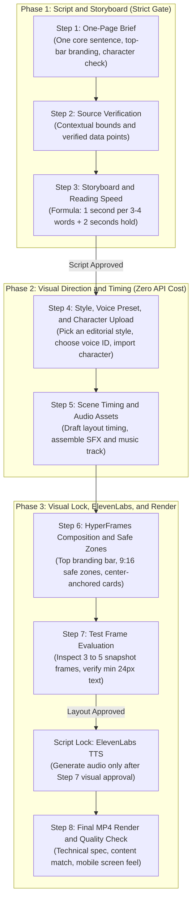

# Motion Graphics Step by Step for Newbies

[](https://opensource.org/licenses/MIT)
[](#)
[](#)
[](#)

A practical, step-by-step workflow for creating high-retention educational motion graphics for vertical video (9:16 Instagram Reels, TikTok, and YouTube Shorts) or standard 16:9 formats.

This workflow combines web standards (HTML5, CSS, and GSAP) with the HyperFrames render engine, ElevenLabs narration, and real recorded audio. It replaces generic AI videos with grounded editorial layouts, proper safe zones, and disciplined pacing.

---

## The Problems This Workflow Fixes

Most automated video tools produce files that look bad on phones for predictable reasons:

1. **Broken Safe Zones and Cut-off Text**: Rotated stickers, badges, and card plates drift off-screen or collide with mobile UI overlays (the Reels caption box, account handles, and action buttons).
2. **Plastic Visuals**: Generic 3D renders with smooth, rubbery surfaces that look fake. Real human viewers engage more with tactile paper textures, collage cutouts, and editorial typography.
3. **Mismatched Narratives**: The voice talks about undersea internet cables while the visual shows a generic floating robot or gold coins. Visuals must track what the script says, beat by beat.
4. **Ruined Pacing**: Scripts with awkward three-second pauses, or videos sped up to 1.3x where the speaker sounds frantic and viewers cannot digest the facts.
5. **Burned API Credits**: Generating voice audio on draft one, only to rewrite lines three times during visual edits and waste paid character quotas.

This guide enforces a strict sequence: nail the script and timing first, lock the visual layout second, generate voice audio once, and render.

---

## The 8-Step Pipeline



---

## Detailed Step Breakdown

### Step 1: One-Page Brief
* **The One-Sentence Rule**: Every video must state its core takeaway in exactly one sentence. If you cannot explain the main point in one sentence, the brief is not ready.
* **Header Branding**:
  * **Top-Left ($Y = 160\text{px}$)**: Series name or topic tag (example: `AI INFRASTRUCTURE // EP 01`).
  * **Top-Right ($Y = 160\text{px}$)**: Creator handle or credit (example: `@yourhandle`).
* **Character Check**: Decide upfront if the video features an on-screen host or relies strictly on technical diagrams and typography.

### Step 2: Source Verification
* State real numbers and cite where they come from. Avoid vague claims like "studies show" or "scientists found."
* For religious or legal citations, include the exact reference, chapter, or verse number, labeled clearly as a summary of meaning.

### Step 3: Storyboard and Reading Speed
* Structure the script into 5 to 6 beats. For a 60-second video, keep the total script between 125 and 135 words.
* **The Reading Speed Formula**:
  $$\text{Display Duration} \ge \left( \frac{\text{On-Screen Words}}{3.5} \right) + 2.0\text{ seconds}$$
* *Example*: A text card with 14 words needs at least **6.0 seconds** on screen so viewers can read it without rushing.
* Keep camera moves still while text cards are being read.

### Step 4: Visual Style, Voice Selection, and Character Import
*(Proceed here only after the Step 3 script is approved)*
* **Pick an Editorial Style**:
  1. *Collage Cartoon*: Cream textured paper (`#fcfbf9`), photo cutouts, tape accents, and handwritten script.
  2. *Visual Journalism*: Dark charcoal backgrounds, subtle film grain, archive photos, and bright highlighter ink.
  3. *Minimalist White Catalog*: Technical ivory grid, product callouts, and red rubber stamps.
  4. *Vintage Engraving*: Aged sepia parchment, copperplate etchings, and serif headers.
  5. *Vector Route*: Isometric vector paths with running telemetry badges.
  6. *Stage Puppet*: Punchy color blocks with interactive character actions.
  7. *Kinetic Typography*: Swiss poster layout, high-contrast type (`Sora` 900), and rapid text transitions.
* **Voice Preset**: Pick an ElevenLabs voice ID or voice profile that fits the mood.
* **Character Asset**: If using an on-screen host, import a transparent PNG cutout with clothes and hands intact.

### Step 5: Scene Timing and Sound Beds (Zero API Cost)
* Build the timing track using estimated reading durations.
* Gather background music and real sound effects (whoosh, click, card impact, and paper slide). Do not synthesize beeps in code.

### Step 6: HyperFrames Composition and Safe Zones
* **9:16 Mobile Margins**:
  * Left and right margins: at least $110\text{px}$.
  * Top margin: at least $160\text{px}$ (clears mobile camera notches).
  * Bottom margin: at least $260\text{px}$ (clears Reels captions, audio tags, and buttons).
* **Center Anchoring**: Never position rotated badges or cards from arbitrary left percentages. Always anchor to center (`left: 50%`, `transform: translateX(-50%) rotate(...)`) to prevent edges from poking off-screen.
* **Host Character Rig**: Keep the character on-screen across beats. Separate head and mouth elements so head bobs and lip-sync flaps trigger without tearing the body.

### Step 7: Test Frame Evaluation (Human Approval Gate)
* Render 3 to 5 full-resolution PNG screenshots from the busiest seconds using Chrome Headless.
* Check text readability: body text must be at least $24\text{px}$ on a $1080 \times 1920$ canvas. Check that badges do not overlap the character or text.

### Script Lock Protocol
> [!IMPORTANT]
> **Do not call the ElevenLabs API until Step 7 is approved.**
> Locking the script and visual layout first means you generate voice audio once. You avoid wasting paid character quotas on discarded drafts.

### Step 8: Full Render and Quality Control
* Render the complete video at 30 fps using HyperFrames.
* Mix audio to the broadcast standard:
  * Voiceover normalized to **`-16 LUFS`** with true peaks below **`-1.5 dBFS`**.
  * Background music ducked to between **`-18 dB`** and **`-22 dB`** during speech.
  * Organic SFX aligned to visual impact frames.
* Complete the three-layer quality check: technical specifications (1080x1920, H.264), content fidelity (script matches visual points), and phone screen feel.

---

## Attribution and Licenses

This repository builds on open tools and documented methodologies from the following creators:

| No | Component / Methodology | Creator / Project | License | Role in This Pipeline |
|---|---|---|---|---|
| 1 | **Beginner's Motion Guide** | `@Traa-Bud` / `@wgmpb` | Open Educational Guide | Core methodology, one-sentence brief rule, reading-time math, and 3-layer quality check. |
| 2 | **Bang Motion** | [Bang Tutorial](https://youtube.com/bangtutorial) (`bangtutorial/bang-motion`) | **MIT License** | 7 editorial visual styles, color palettes, typography pairings, and paper textures. |
| 3 | **HyperFrames** | [HyperFrames Core](https://github.com/hyperframes) | **MIT License** | Deterministic HTML5, CSS, and GSAP frame-by-frame video render engine. |
| 4 | **Barty-Bart Sound Effects** | [Barty-Bart](https://github.com/Barty-Bart) (`Barty-Bart/motion-graphics`) | **CC0 / Free Commercial** | Real sound design rules, -16 LUFS loudness standard, and dynamic music ducking. |
| 5 | **ElevenLabs** | [ElevenLabs](https://elevenlabs.io) | API Service | High-clarity neural narration and the deferred Script Lock credit-saving protocol. |
| 6 | **Rembg** | [Daniel Gatis](https://github.com/danielgatis/rembg) (`danielgatis/rembg`) | **MIT License** | Background removal tool for clean transparent character cutouts. |
| 7 | **TASTES.md & ISS** | Indonesian Social Survey (ISS) | **MIT License** | Warm editorial design constraints (cream paper, charcoal ink, terracotta accents). |

---

## How to Install and Use

### 1. In a Single Project
Copy this repository into your project's agent skills directory:
```bash
<your-project>/.agents/skills/motion-edukasi-hyperframes/
```

### 2. As a Global Skill
Copy this repository to your global Antigravity, Cursor, or Claude Code configuration:
```bash
~/.gemini/antigravity/skills/motion-edukasi-hyperframes/
```

### 3. Running Production
Prompt your coding agent:
> *"Create an educational motion graphics video using the motion-edukasi-hyperframes skill."*

The agent will walk through the pipeline step by step, starting with Step 1 (One-Page Brief), protecting safe margins, and holding voice generation until your visual test frames are approved.

---

## License

This project is licensed under the [MIT License](LICENSE). You are free to use, modify, and distribute it for personal and commercial projects.
